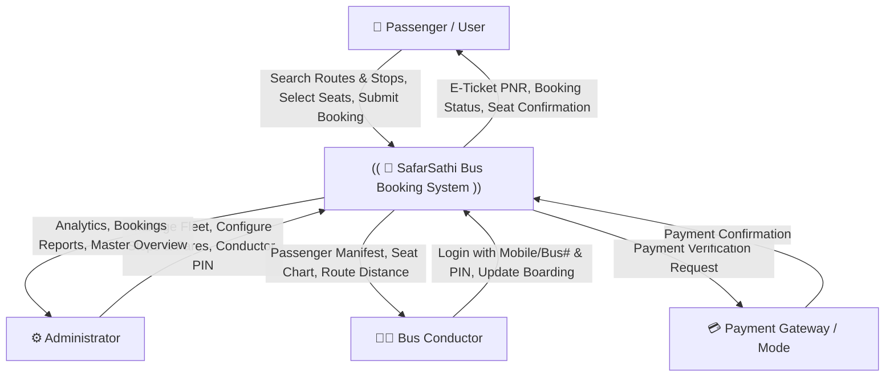
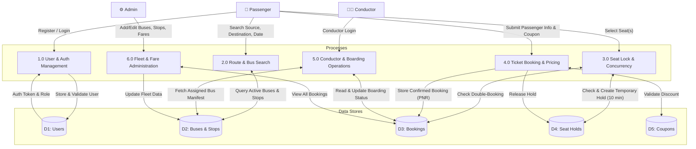
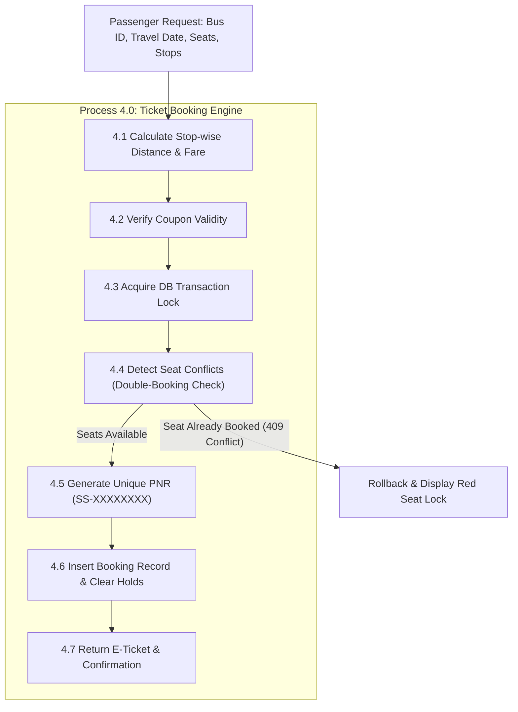

# SafarSathi - Data Flow Diagrams (DFD)

---

## 1. DFD Level 0 (Context Level Diagram)
The Level 0 Context Diagram describes the boundary of the SafarSathi system and its direct interactions with external entities: Passenger, Conductor, Administrator, and Payment Gateway.

---

## 2. DFD Level 1 (High-Level Process Breakdown)
Decomposes the core processes and maps them directly to persistent data stores:

---

## 3. DFD Level 2 (Booking & Concurrency Process 4.0 Sub-system)
Details how the system handles pricing calculation, ACID transactions, and double-booking lockout.

