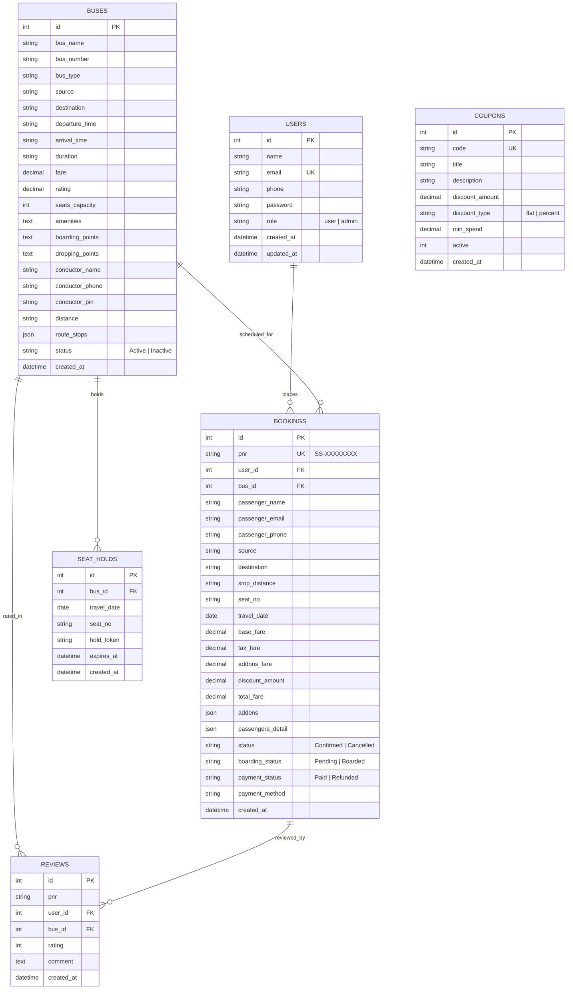

# SafarSathi - Entity-Relationship (ER) Diagram

---

## 1. Database Entity-Relationship Architecture
Represents all system entities, primary keys, foreign keys, constraints, and relationships.

---

## 2. Entity Descriptions & Cardinality
1. **USERS**: Stores customer and administrator profiles.
   - `USERS` to `BOOKINGS` (1:N): One registered user can place multiple ticket bookings.
2. **BUSES**: Stores bus fleet, conductor credentials, and intermediate stop configurations.
   - `BUSES` to `BOOKINGS` (1:N): One bus serves multiple bookings across different dates and seats.
   - `BUSES` to `SEAT_HOLDS` (1:N): Tracks concurrent 10-minute temporary seat locks.
3. **BOOKINGS**: Central transaction record storing PNR, passenger details, selected stops, and boarding status.
4. **COUPONS**: Promotional discounts applied dynamically against base fare.

