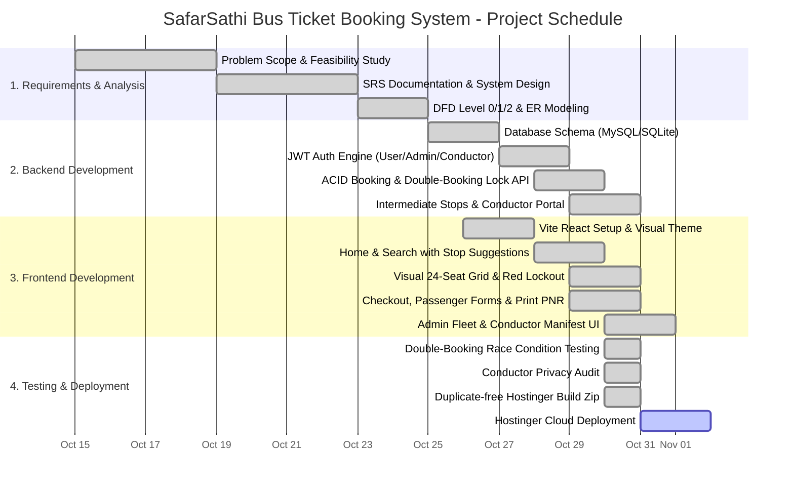

# SafarSathi - Project Development Gantt Chart

---

## 1. Project Lifecycle Timeline

---

## 2. Milestone Summary Table

| Phase | Milestone | Deliverables | Status |
| :--- | :--- | :--- | :--- |
| **Phase 1** | Requirement Analysis | SRS document, Level 0/1/2 DFD, ER Diagram | Completed |
| **Phase 2** | Backend & API | PHP REST Controllers, JWT Token, ACID Concurrency | Completed |
| **Phase 3** | Frontend SPA | React 18 UI, 24-seat visual map, Stop-wise pricing | Completed |
| **Phase 4** | Testing & Deployment | Conductor privacy, Hostinger MySQL configuration | In Progress |

