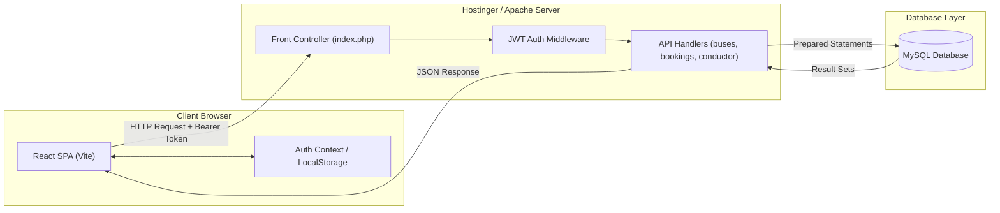

# SafarSathi - System Architecture & Design Model

---

## 1. 3-Tier Layered Architecture Model

```
┌────────────────────────────────────────────────────────┐
│             PRESENTATION TIER (Frontend)               │
│  React 18 + Vite (SPA)                                 │
│  ├── React Router v6 (Protected / Admin Routes)       │
│  ├── Context API (AuthContext, Session Management)     │
│  ├── Responsive Layouts & Visual Seat Matrix (24 seats)│
│  └── Centralized API Service (api.js)                  │
└───────────────────────────┬────────────────────────────┘
                            │ HTTPS / REST (JSON) + JWT
┌───────────────────────────▼────────────────────────────┐
│              APPLICATION TIER (Backend API)            │
│  PHP 8 REST Controller / Micro-router                  │
│  ├── Route Dispatcher (index.php)                      │
│  ├── Auth & JWT Token Engine (HMAC-SHA256)             │
│  ├── Concurrency Lock & ACID Transaction Manager       │
│  ├── Stop-wise Fare Calculation Engine                 │
│  └── Conductor Manifest & Boarding Controller          │
└───────────────────────────┬────────────────────────────┘
                            │ PDO Prepared Statements
┌───────────────────────────▼────────────────────────────┐
│                DATA TIER (Persistence)                 │
│  MySQL 8 / MariaDB (Production Hostinger)              │
│  [Fallback: SQLite for Local Development]              │
│  ├── Relational Tables (Users, Buses, Bookings)        │
│  ├── Atomic Indexes & Foreign Keys                     │
│  └── Temporary Seat Holds (Anti-Race Condition)        │
└────────────────────────────────────────────────────────┘
```

---

## 2. Component Interaction & Design Patterns

### 2.1 Component Flow Diagram


### 2.2 Core Design Principles
1. **Decoupled Client-Server**: Separation of frontend presentation and backend API.
2. **Stateless JWT Authentication**: No session state stored on the server; secure tokens signed with HMAC-SHA256.
3. **Self-Healing Schema Upgrade**: The database automatically migrates new columns (`route_stops`, `stop_distance`, `boarding_status`) upon startup without requiring manual SQL commands.
4. **ACID Transaction Isolation**: Prevents race conditions during simultaneous booking attempts.

